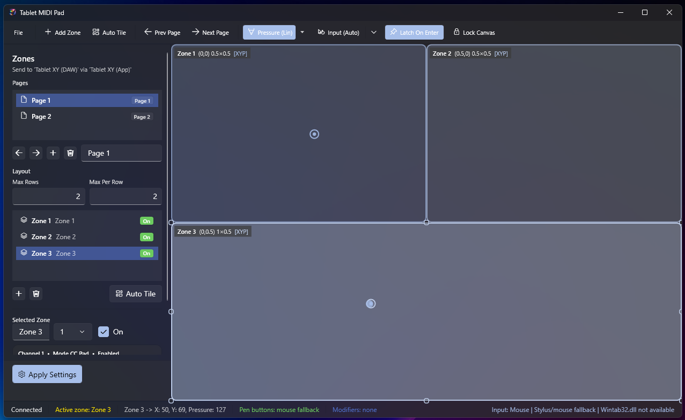
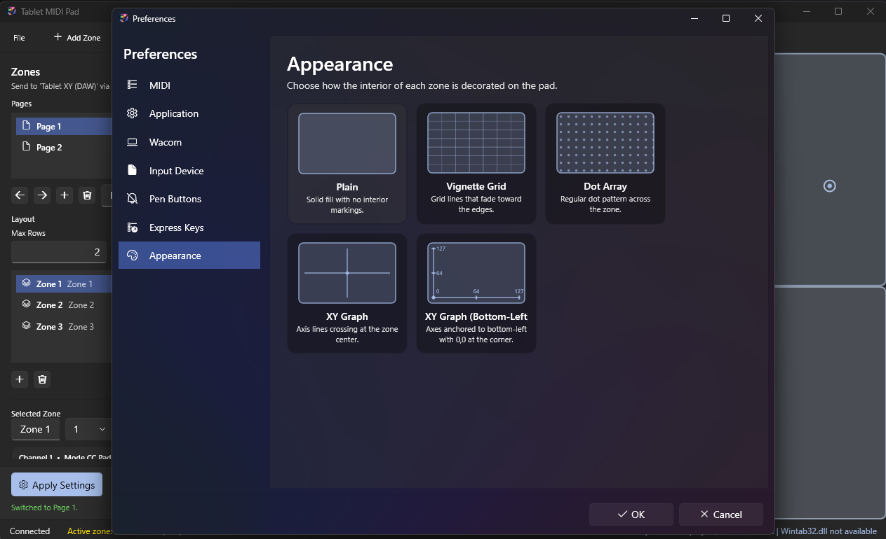
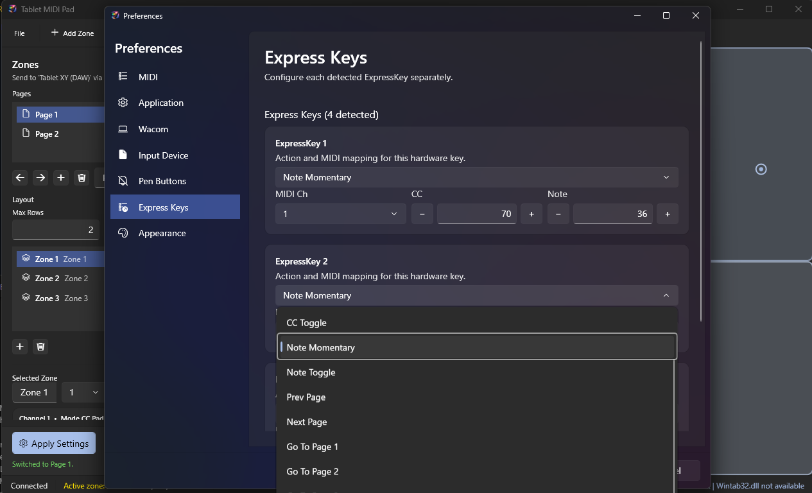
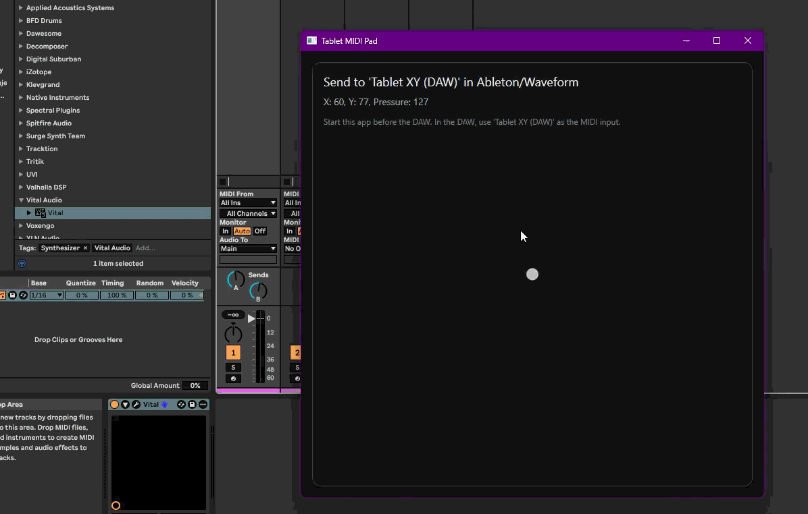

# TabletMidiPad

`TabletMidiPad` is a Windows WPF utility that turns tablet, pen, stylus, or mouse movement into MIDI CC data for a DAW.







The app creates a configurable control surface with rectangular zones. Each zone can send its own MIDI channel and CC assignments for:

- X position
- Y position
- pressure

It uses:

- **Windows MIDI Services** for loopback MIDI endpoints
- **Wintab** for direct Wacom pen input when available
- WPF stylus/mouse fallback when Wintab is unavailable

## Features

- runtime settings UI inside the app
- multiple rectangular zones
- per-zone MIDI channel
- per-zone CC numbers for X, Y, and pressure
- per-zone inversion and pressure behavior
- configurable lower and upper pen-button actions
- auto-tiling for newly added zones
- optional zone locking until release
- optional target-application gating
- optional always-on-top window mode
- Windows MIDI Services loopback creation at startup
- direct Wacom/Wintab pen input support

## Requirements

- Windows 11
- **Windows MIDI Services Runtime and Tools**
- `.NET 10 Desktop Runtime` to run a framework-dependent build
- a DAW or MIDI-capable app that can receive CC data

For direct Wacom pen input:

- a supported Wacom driver installation
- **Wacom Professional Service** (`WTabletServicePro`) running
- `Wintab32.dll` available through the installed driver
- if you want to start `WTabletServicePro` from inside `TabletMidiPad`, Windows may require running the app as administrator

The app resolves `midi.exe` from your `PATH` (default after Windows MIDI Services Tools install).
If needed, override the executable path with environment variable `TABLETMIDIPAD_MIDI_EXE_PATH`.

## Runtime configuration

Settings are edited in the built-in sidebar and saved to `%AppData%\TabletMidiPad\config.json`.
On first run after upgrading from older builds, a legacy `config.json` next to the executable is migrated automatically if present.

Available settings include:

- DAW input port name
- internal app port name
- loopback association id
- mouse pressure fallback value
- lower pen-button action, MIDI channel, CC, and note
- upper pen-button action, MIDI channel, CC, and note
- keep window always on top
- allow switching zones without releasing
- only send MIDI while a selected target app is active
- per-zone enable/disable
- per-zone MIDI channel
- per-zone CC X / CC Y / CC Pressure
- per-zone bounds
- per-zone invert X / invert Y
- per-zone pressure enable
- per-zone pressure reset-on-release

## MIDI routing

At startup the app creates a temporary Windows MIDI Services loopback pair:

- `Tablet XY (App)`
- `Tablet XY (DAW)`

The app writes MIDI to `Tablet XY (App)`.
Your DAW should listen to `Tablet XY (DAW)`.

These endpoints are temporary and are removed when the app closes.

## Input backends

The app prefers direct **Wintab** pen input when available. If Wintab is unavailable, it falls back to WPF stylus/mouse input.

The HUD shows the current input backend so you can verify whether the app is using:

- `Wintab`
- `Stylus`
- `Mouse`

### Wacom / Wintab notes

For Wintab to work:

- the Wacom driver must be installed correctly
- `WTabletServicePro` must be running
- `WTInfoA(0, 0, NULL)` must respond through `Wintab32.dll`

The app also applies Wintab context locking and overlap recovery so pen input can continue working even when `TabletMidiPad` is not the foreground window on compatible setups.

This behavior depends on the driver and environment. It is more reliable when:

- the Wacom service is running normally
- no broken tablet preference state is interfering
- the driver is not being restarted mid-session

### Wacom pen button setup

If you want both pen side buttons to work in `TabletMidiPad`, configure them in **Wacom Center** so the driver exposes normal pen button events instead of scroll behavior.

Recommended setup:

- set one side button to `Click`
- set the other side button to `Right Click`
- do **not** leave a side button mapped to `Scroll` if you want the app to use it

On the tested setup:

- lower pen button (`Click`) reports as `mask=0x0002`, `pressed=2`
- upper pen button (`Right Click`) reports as `mask=0x0004`, `pressed=3`

`TabletMidiPad` now has separate global actions for:

- Lower Pen Button
- Upper Pen Button

You can set each one independently in `Preferences`.

## Zone behavior

Each zone is defined by normalized bounds:

- `Left`
- `Top`
- `Width`
- `Height`

All values are relative to the full pad from `0.0` to `1.0`.

X and Y are normalized **within the active zone**, not across the whole pad. Each zone gets its own local `0-127` range.

If the pointer or pen is outside all enabled zones, the app sends nothing.

When zone switching is disabled, the currently pressed zone stays active until release even if the pointer crosses into another zone.

Each zone also has a `Release Behavior`:

- `No Send On Release`
- `Hold`
- `Reset Pressure Only`
- `Reset All`

## Target application gating

If `Only send MIDI while selected app is active` is enabled, the app checks the current foreground window and only emits MIDI while the chosen target app is active.

This is useful when you want the controller behavior tied to a DAW window without manually disabling the app.

Important: target-app gating controls whether MIDI is sent. It does **not** replace Wintab itself or create cross-process tablet ownership.

## DAW setup

### Ableton Live

1. Start `TabletMidiPad`.
2. Launch Ableton after the app is already open.
3. Open `Preferences > Link, Tempo & MIDI`.
4. Under Inputs, find `Tablet XY (DAW)`.
5. Enable `Remote`.
6. Usually also enable `Track`.
7. Enter MIDI Map mode and move on the pad.

### Waveform

1. Start `TabletMidiPad`.
2. Launch Waveform after the app is already open.
3. Select `Tablet XY (DAW)` as the MIDI input.
4. Make sure the target is listening for controller data on the channel used by the active zone.

## Build

From the project directory:

```powershell
dotnet build
```

If the executable is already running, build to another output folder:

```powershell
dotnet build -p:OutDir=bin\Verify\
```

## Publish

Framework-dependent publish:

```powershell
dotnet publish -c Release -r win-x64 --self-contained false
```

This keeps the package much smaller than a self-contained publish, but the target machine still needs:

- `.NET 10 Desktop Runtime`
- Windows MIDI Services Runtime and Tools

## Troubleshooting

### The DAW does not see the MIDI device

- confirm Windows MIDI Services Runtime and Tools are installed
- confirm `midi.exe` is available in `PATH` (or set `TABLETMIDIPAD_MIDI_EXE_PATH`)
- start the app before starting the DAW
- fully restart the DAW after launching the app

### Wintab does not activate

- confirm the Wacom driver is installed
- confirm `WTabletServicePro` is running
- confirm `Wintab32.dll` is present
- if the in-app `Start Service` button fails, try running `TabletMidiPad` as administrator or start `Wacom Professional Service` from Windows Services
- if needed, reboot after installing or updating the driver

If Wintab is unavailable, the app will fall back to stylus/mouse input.

### Pen input only works while the app is active

Make sure the Wacom service is running and use the current build, which includes Wintab overlap recovery and context locking.

Behavior can still vary by driver and device configuration, but this build is designed to keep the Wintab context alive more aggressively than a default setup.

### The MIDI device appears but mapping does nothing

- in Ableton, enable `Remote` for `Tablet XY (DAW)`
- make sure the DAW is listening to `Tablet XY (DAW)`, not `Tablet XY (App)`
- verify the mapping target is learning CC input, not note input
- make sure you are inside an enabled zone

### Build fails because the executable is locked

Close the running app and build again, or build to another output folder:

```powershell
dotnet build -p:OutDir=bin\Verify\
```

## Project structure

- [MainWindow.xaml](C:\Users\Owner\Projects\wacom-midi\TabletMidiPad\MainWindow.xaml): main UI
- [MainWindow.xaml.cs](C:\Users\Owner\Projects\wacom-midi\TabletMidiPad\MainWindow.xaml.cs): MIDI, Wintab, input handling, and runtime config logic
- [AppConfig.cs](C:\Users\Owner\Projects\wacom-midi\TabletMidiPad\AppConfig.cs): saved configuration model
- [WintabInterop.cs](C:\Users\Owner\Projects\wacom-midi\TabletMidiPad\WintabInterop.cs): Wintab interop definitions
- [TabletMidiPad.csproj](C:\Users\Owner\Projects\wacom-midi\TabletMidiPad\TabletMidiPad.csproj): project file

## License

MIT. See [LICENSE](C:\Users\Owner\Projects\wacom-midi\TabletMidiPad\LICENSE).
